# WinTools V1 interface (2026-10-21)

The visual and audio language of V1: the radial menu, the feedback surfaces, the tray and the settings window. The decisions and their reasons are in ADR-0016. Every image here was rendered by the product's own code: `tests/WinTools.Preview` draws the native surfaces off screen at 120 DPI and captures the settings window.

## Principles
- **Quiet, fast, premium:** dark neutral surfaces, one accent, short motion, soft sounds. Nothing flashes or blinks, and nothing takes the focus away from Explorer.
- **Green means "this is the one":** selection, the armed command, progress, success and the mark. Everything else is neutral. Red and amber appear only for failures and warnings.
- **Never colour alone:** each state also changes shape or lightness.
- **The interaction rules are unchanged** (ADR-0014). The look follows the state; it never decides what a drop does.

## Palette
| Token | Value | Use |
|---|---|---|
| Base | `#111714` | Overlay disc, window background |
| Surface | `#1D2621` | Sectors, cards |
| Raised | `#263129` | Hovered sector, secondary surface |
| Sunken | `#161D19` | Back, the hub, input fields |
| Edge | `#2C3832` | Hairlines, rims, sector gaps |
| Green | `#22C55E` | Accent: mark, progress, switches |
| Green hover | `#2DDC78` | Hover lip and hovered icons |
| Green armed | `#4ADE80` | Armed command, success icon |
| Text | `#F4F7F5` | Primary text |
| Text secondary | `#9AA69F` | Hints, Back, labels in the info panel |
| Text on green | `#07140C` | Text on the armed sector and on green buttons |
| Error | `#F07171` | Failure icon |
| Warning | `#E8B04B` | Partial failure, GPS location in Image info |

Contrast, as WCAG ratios; `UiSurfaceTests.Text_and_state_colours_have_enough_contrast` checks these:

| Pair | Ratio |
|---|---|
| Text on Surface | 14.4 |
| Text on Raised | 12.5 |
| Text secondary on Surface | 6.2 |
| Text secondary on Sunken | 6.8 |
| Text on green on Green armed | 10.8 |
| Warning on Surface | 7.9 |
| Error on Surface | 5.4 |
| Hover lip on Raised | 7.5 |
| Armed sector against a Surface neighbour | 8.9 |

## Type, size and spacing
- **Font:** Segoe UI with ClearType.
- **Ring labels:** 12.5 px at 96 DPI, semibold. A label that does not fit goes onto two lines (split at a space or after "×"), then 92 % and 85 % of the size. A test checks that no known label needs an ellipsis at 96, 120, 144 or 192 DPI.
- **Toast:** 13.5 px semibold title, 12 px detail.
- **Info panel:** 12 px.
- **Radii:** cards 10–12 px, controls 6 px.
- **Margins:** 16–18 px inside cards, 14 px of shadow margin around native cards.
- **Scaling:** every size scales with the monitor's DPI (per-monitor V2). The geometry of the ring is unchanged: radius 110 px, dead zone 28 px, a deep stroke from 80 px opens a category.

## Radial menu
| State | Image | What changes |
|---|---|---|
| Waiting (before the first DragEnter) |  | Empty band and the mark; never "No actions" for files that have commands |
| Categories | 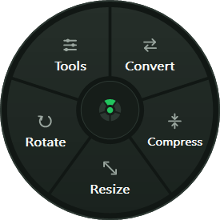 | Icon above each label; the mark in the hub |
| Hovered category | 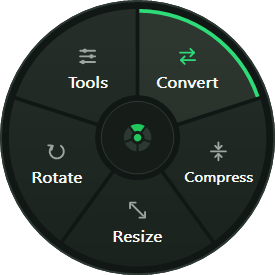 | Raised surface, green lip on the rim, green icon |
| Category ring | 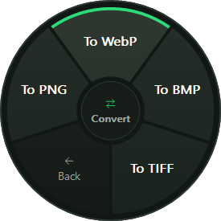 | Hovered command (not armed yet): raised and lipped |
| Armed command | 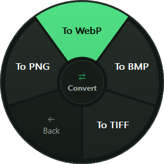 | Filled armed green, grown 4.5 px towards the rim, dark text: a release runs it |
| Back hovered | 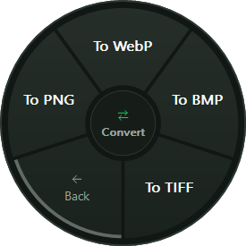 | Darker sector with an arrow; grey lip, never green |
| Dense ring (Resize, 8 sectors) | 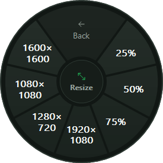 | Sizes on two lines |
| Tools | 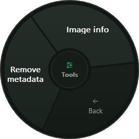 | Long labels wrap |
| No actions (unsupported file) | 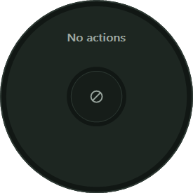 | Neutral ring, "No actions", a no-entry glyph |

- **Sectors:** separated by a 3 px gap of the base colour, with a slight vertical gradient for depth.
- **Hub:** the mark on the categories' ring; the open category's icon and name on its ring.
- **Icons:** drawn as vectors on a 24-unit grid with a 2-unit stroke and round caps (`Icons.cs`). There are no icon files and no emoji.

### Motion
| Change | Duration | Easing | Notes |
|---|---|---|---|
| Ring appears (show, or level change) | 120 ms | ease-out cubic | Content scales from 92 % and fades in from 73 % (readable in the first frame). The disc itself is complete and opaque at once |
| Hover in or out | 90 ms | ease-out cubic | Per sector, so leaving and entering cross-fade |
| Armed | 70 ms | ease-out cubic | Starts from zero on each new hot command |
| Toast in / out | 140 / 180 ms | ease-out cubic | 10 px slide up with a fade; a fade out |

- **Animations setting:** "Follow Windows" (the default, which reads *Animation effects*), On or Off. Reduced motion shows every change at once.
- **Frames:** about 0.6 ms each at 120 DPI. They are driven by a timer only while something moves.

## Sound
All sounds are synthesised in `SoundBank.cs`: sums of decaying sine partials, a 1 ms fade at both ends, 16-bit mono at 44.1 kHz, peak at most 0.2 of full scale. There are no recorded, sampled or third-party sounds.

| Sound | When | Character |
|---|---|---|
| Tick | The pointer comes onto a different sector of the same ring | 22 ms, 2.45 + 3.9 kHz, decays in a few ms |
| Level | A category opens, or Back returns to the categories | 70 ms, a soft "tock" at 1.18 + 1.77 kHz |
| Success | A job produced every file | 300 ms, two rising bell-like notes (A5, E6) |
| Failure | Any file failed | 360 ms, two falling muted notes (G4, E♭4) |
| Nothing | Nothing needed doing, or a release came before the command was armed | 140 ms, one soft 660 Hz note |

Rules (`NavigationSounds`, tested):
- **Ticks:** one tick per change of sector. Staying on a sector, or leaving to the hub and coming back to the same one, is silent.
- **Rate:** ticks are at least 45 ms apart, with 80 ms of quiet after a level sound, so a fast sweep gives a few ticks, not one per sector. Held-back ticks are dropped, not queued.
- **Thread:** sounds play on their own thread. The overlay thread only enqueues.
- **Setting:** "UI sounds" On or Off (default On). Off, no audio thread is started. The volume follows WinTools' entry in the Windows volume mixer.

## Feedback
| Toast | Image |
|---|---|
| One file | 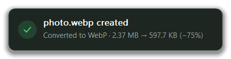 |
| A batch with failures | 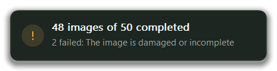 |
| A failure | 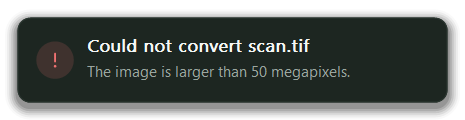 |
| Nothing to do | 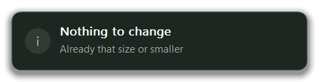 |
| Progress (a batch still running after 450 ms) | 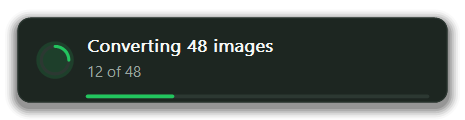 |

- **Where:** bottom-right of the work area of the monitor where the drop happened.
- **Input:** click-through and never activated.
- **Duration:** 3.5 s for success or nothing to do, 7 s for a failure or partial failure. One toast at a time.
- **Text:** the new file's name, what was done, and the size before and after. A failure gives its reason in plain words, never an error code, worker text or path. The detailed result stays in the local log.

**Image info:** a card beside the drop point. It never takes focus, and a click anywhere on it closes it.

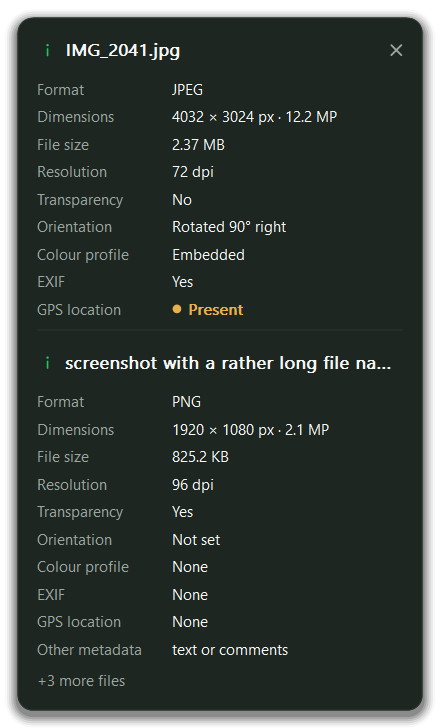

## Tray
- **Icon:** the WinTools icon with the tooltip "WinTools: drag images, press Space" (it names the configured key).
- **Menu:** Settings…, Open logs folder, Exit WinTools.
- **Double click:** opens Settings.
- **Explorer restart:** the icon comes back.

## Settings window
| | |
|---|---|
| 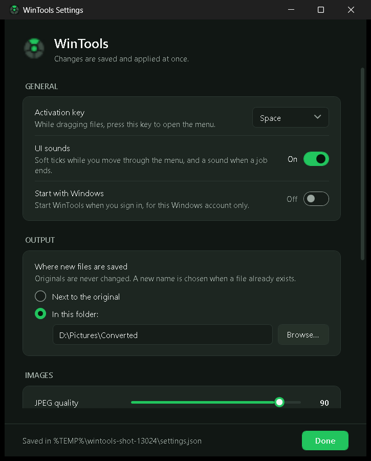 | 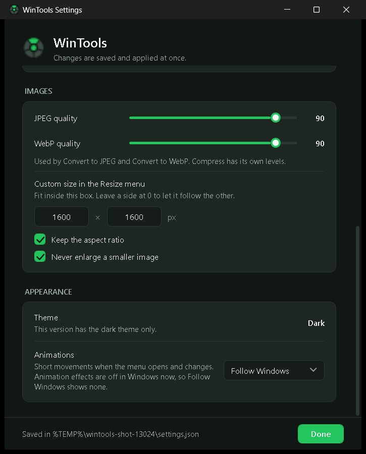 |

- **Sections:** General (activation key, UI sounds, Start with Windows), Output, Images (qualities, custom resize size, aspect ratio, no enlarging) and Appearance (dark theme only in V1, Animations).
- **Saving:** every change is saved a moment later and applied by the running host at once. There is no Apply button.
- **Keyboard and screen readers:** focus is shown with a green outline, and every control has an automation name.
- **Privacy:** the footer writes the user's folders as `%APPDATA%` and similar, never the profile path.

## Product icon
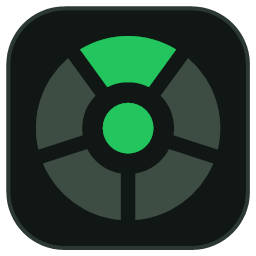

The mark is the radial menu reduced to a symbol: five segments around a hub, one lit in the accent, on a dark rounded tile. `tests/WinTools.Preview --icon` generates `src/WinTools.Host/Assets/WinTools.ico` (16–256 px, PNG frames) from the same vector code. The icon is original, with no third-party artwork.

## Asset provenance
| Asset | Source |
|---|---|
| Icons in the menu and toasts | Vector code in `src/WinTools.Windows/Rendering/Icons.cs`, written for this project |
| Product icon | Generated by `tests/WinTools.Preview` from `Icons.Mark` |
| Sounds | Synthesised at run time by `src/WinTools.Core/Feedback/SoundBank.cs` |
| Font | Segoe UI, part of Windows; not redistributed |
| Images in this document | Rendered by the product's code (`tests/WinTools.Preview`), with fictitious file names and folders |

## Known limitations of the V1 interface
- Dark theme only.
- The overlay has no UI Automation provider, and there is no keyboard path to the commands (UX-007, ADR-0016).
- No cancel button for a running batch.
- The toast shows no "open folder" action: results are never opened automatically, and V1 adds no click actions to the toast.
- The mixed-DPI and multi-monitor manual protocol has not been run; one monitor at 120 DPI was tested.
